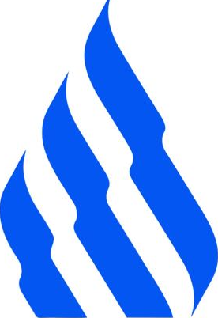

# Farhan Adiyasa

Fullstack and backend software engineer based in Jakarta, Indonesia. Building backend services, API gateways, and autonomous agent workflows.

  
  
  
  

---

## Projects

- **[Fomo Tech Generator](https://github.com/FarhanAdiyasa/FomoTechGenerator)** — Scans GitHub repositories for outdated dependencies and technical debt, then generates modernization roadmaps. Built with Next.js and Gemini API.
- **[Natixis Multi-Modal AI Engine](https://github.com/FarhanAdiyasa)** — Speech-to-text, grammar correction, and text-to-speech pipeline. 3rd place at the 2024 Natixis Hackathon.
- **[Guru Kita](https://github.com/FarhanAdiyasa/Guru-Kita)** — Civic data tool comparing regional teacher salaries against provincial living costs in Indonesia.
- **[Ideally](https://github.com/FarhanAdiyasa/Ideally)** — CMS and operational management platform for landscaping operations with sales analytics. Built with Laravel.

---

## Stack

  

- **Backend & Architecture:** Spring Boot, Laravel, NestJS, Clean Architecture, REST APIs
- **Datastores & Infra:** PostgreSQL, MySQL, Redis, Docker, Linux
- **AI & Automation:** Autonomous agent workflows, custom agent skills, browser automation

---

## Stats

  
  

